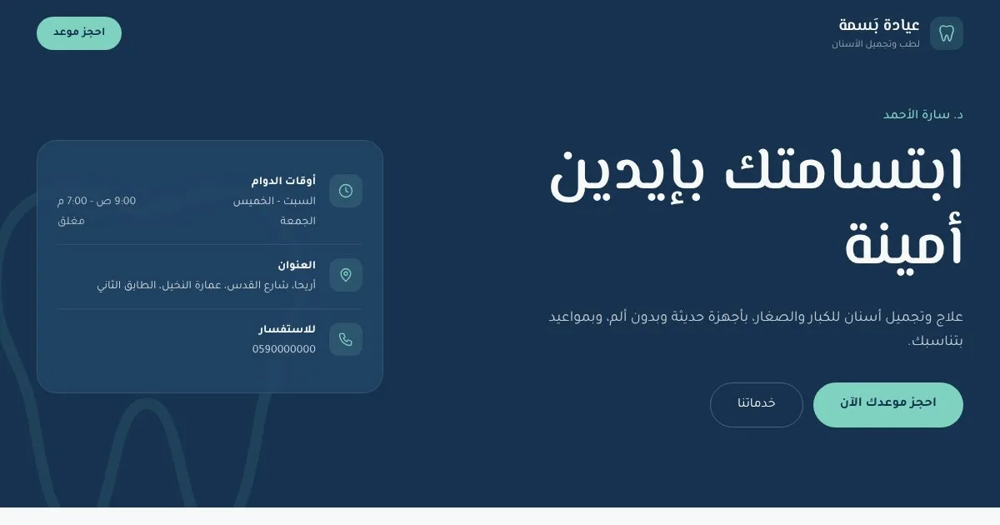

# Basma Dental Clinic — Booking Page

A dental clinic landing page with an appointment form that sends bookings to the clinic's email.

**Live:** [dental-clinic-tau-fawn.vercel.app](https://dental-clinic-tau-fawn.vercel.app) · Part of my [portfolio](https://aya-khamaysa-portfolio.vercel.app)



## Highlights

- **Appointment form** that checks the phone number before sending.
- **No backend:** bookings are delivered by email through Formspree.
- Services, clinic details and soft motion with Framer Motion, Arabic and mobile first.

## Built with

React · Formspree · Framer Motion · Tailwind CSS · Vite

## Run locally

```bash
npm install
npm run dev
```

### Connect the form to an email
1. Create a free account on [formspree.io](https://formspree.io).
2. New Form → enter the clinic's email.
3. Copy the form ID (the part after `/f/`) into `formspreeId` in `src/data/clinic.js`.

With an empty `formspreeId` the form runs in demo mode and sends nothing.

## Edit
- Clinic info, services and the form ID: `src/data/clinic.js`

---

Designed & built by **Aya Khamaysa** · [Portfolio](https://aya-khamaysa-portfolio.vercel.app) · [LinkedIn](https://www.linkedin.com/in/ayakhamaysa) · [One Click](https://www.instagram.com/oneclick.ps)
